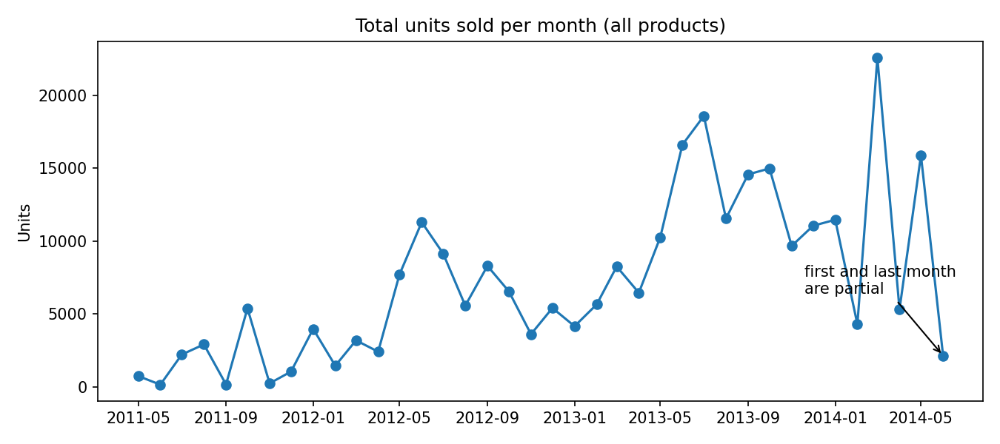
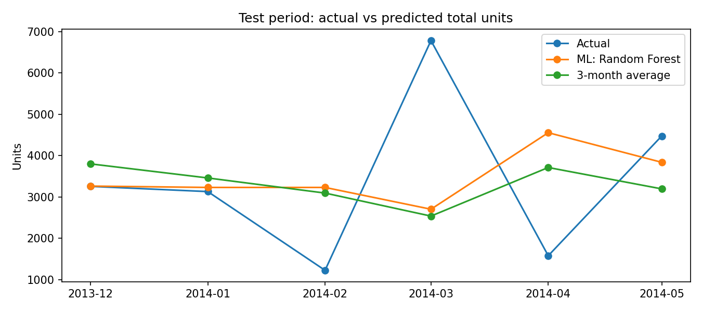
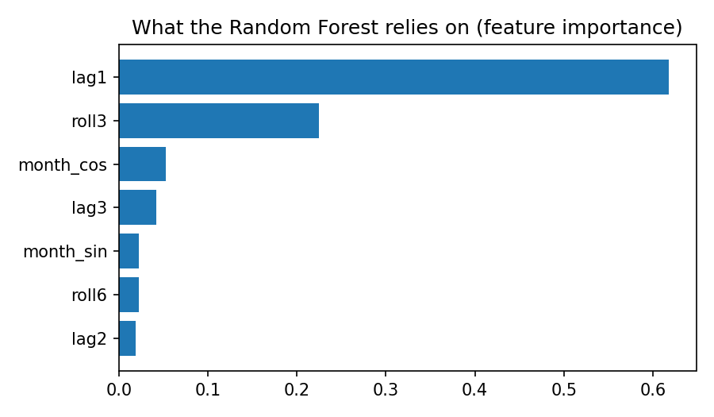
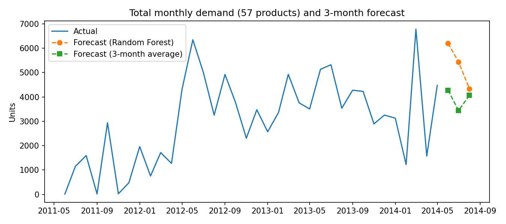
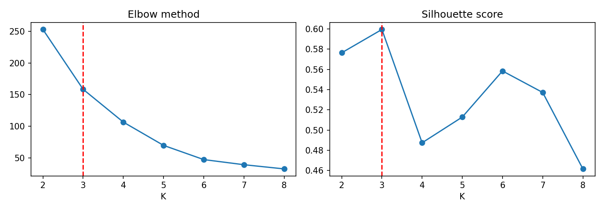
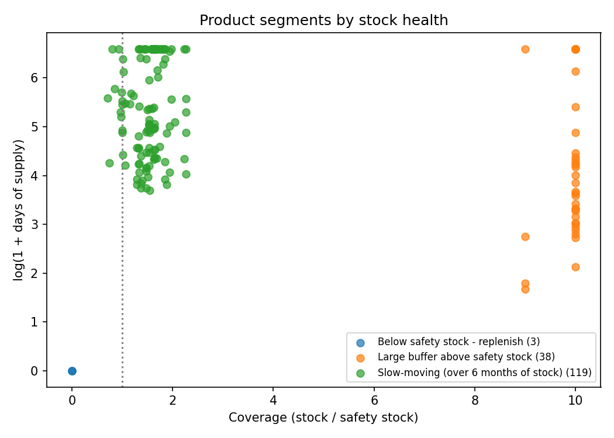
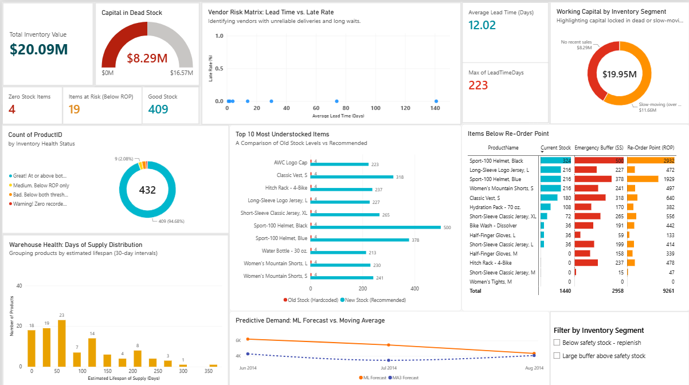
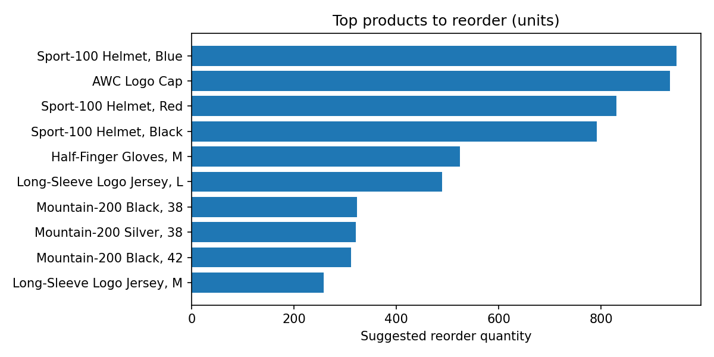

# Inventory Safety & Planning: From Hardcoded Reorder Rules to Evidence-Based Replenishment

> An end-to-end Business Intelligence prototype (SQL Server ETL → dimensional data warehouse → Python data mining → Power BI) that replaces a uniform, hardcoded reorder policy with product-specific, demand-driven safety-stock recommendations.

[](https://colab.research.google.com/drive/16qpv-S1frscvvDClT6qt4fesgjyXG37k)


**Context:** Final project for *Current Topics in Computer Science: Business Intelligence Systems and Analytics* (Vietnamese-German University), Group 8, Topic 12. The source system is **CompanyX**, an AdventureWorks-based SQL Server operational database of a bicycle manufacturer.

**My contribution:** I led the **data mining** workstream (demand forecasting, K-means stock-health segmentation, statistical safety-stock policy) and also contributed to the **ETL** and **Power BI dashboard** workstreams. <!-- Edit this sentence so it matches exactly what you did. -->

---

## Table of Contents

1. [Business Problem and Objectives](#1-business-problem-and-objectives)
2. [Architecture and Toolchain](#2-architecture-and-toolchain)
3. [Data Cleaning: Challenges and Remedies](#3-data-cleaning-challenges-and-remedies)
4. [Data Mining: Why Regression and K-means](#4-data-mining-why-regression-and-k-means)
5. [BI Dashboard Overview](#5-bi-dashboard-overview)
6. [Key Results](#6-key-results)
7. [Limitations and Honest Caveats](#7-limitations-and-honest-caveats)

---

## 1. Business Problem and Objectives

### The problem: a one-size-fits-all reorder rule

In the CompanyX master data, the **reorder point (ROP) is hardcoded to 75% of safety stock (SS)** for all 432 tracked products, regardless of how fast a product sells or how long its supplier takes to deliver. This is structurally flawed:

- A conventional reorder point must cover **expected demand during lead time *plus* a safety buffer**. A trigger that sits *below* the buffer cannot satisfy that definition.
- A fast-selling item can look "well covered" against a trivially small buffer. For example, **AWC Logo Cap** holds 288 units against a stored safety stock of just **4 units** (72× coverage), yet its forecast demand over the next three months is roughly **1,218 units**.

### Objectives

| Objective | What it means in practice |
|---|---|
| **Eliminate the hardcoded rule** | Derive safety stock and reorder point per product from observed demand variability and lead time |
| **Trust the consolidated data** | Reconcile warehouse totals against the source at every grain; preserve historical policy values with SCD Type 2 |
| **Forecast defensibly** | Benchmark regression models against simple baselines on a chronological holdout |
| **Surface risk and idle capital** | Distinguish stock-outs and under-protected items from slow-moving or dormant inventory |
| **Support the planner, not replace them** | Output review candidates and an interpretable reorder scenario instead of automatic purchase approval |

---

## 2. Architecture and Toolchain

```
 CompanyX (OLTP)            CompanyX_DW (OLAP)              Analytics                BI layer
┌──────────────────┐      ┌────────────────────┐      ┌────────────────────┐   ┌──────────────┐
│ Production.*     │      │ DimProduct (SCD-2) │      │ Google Colab       │   │ Power BI     │
│ Purchasing.*     │ ───► │ DimLocation        │ ───► │ Python, pandas,    │──►│ dashboard +  │
│ Sales.*          │ ETL  │ DimDate            │ CSV  │ scikit-learn       │CSV│ tooltip page │
└──────────────────┘      │ FactInventorySnap  │      │ Regression, K-means│   └──────────────┘
  SQL Server (SSMS)       │ FactReplenishment  │      └────────────────────┘
  SSIS + stored procs     └────────────────────┘
```

| Layer | Tooling | Role |
|---|---|---|
| Database engine and querying | **SQL Server Management Studio (SSMS)** | Source exploration, stored procedures, validation queries |
| ETL orchestration | **Microsoft Visual Studio + SQL Server Integration Services (SSIS)** | Control flow that runs the loading procedures in dependency order |
| Scheduling | **SQL Server Agent** | Job `ETL_Topic12_Inventory`, executed every 15 minutes |
| Data mining | **Google Colab (Python)**: pandas, NumPy, scikit-learn, matplotlib | Forecasting, clustering, statistical policy |
| Business intelligence | **Power BI** | Interactive inventory-health dashboard |

### Data warehouse design (Kimball dimensional modelling)

Following the four-step design sequence (business process → grain → dimensions → facts), the warehouse is a small **fact constellation** of two stars sharing conformed dimensions.

| Table | Grain | Notes |
|---|---|---|
| `FactInventorySnapshot` | Date × Product version × Location | Semi-additive stock measures (sum across locations, never across dates) |
| `FactReplenishmentPlan` | Plan date × Product × Location | Historical purchase quantities aggregated by order day |
| `DimProduct` | Product version | **SCD Type 2** on safety stock, reorder point, standard cost, list price |
| `DimLocation` | Location | SCD Type 1 overwrite |
| `DimDate` | Calendar day | SCD Type 0 (immutable attributes) |

### Incremental ETL

- Stored procedures orchestrated by `usp_RunETL`; every step is recorded in `ETL_Log`, and `ETL_Watermark` stores the last successfully processed source timestamp.
- A re-run with no source changes loads **zero** new product or fact rows (idempotent behaviour, verified).
- The first full run loaded **11,657 rows** across five procedures.

---

## 3. Data Cleaning: Challenges and Remedies

Data quality, not modelling, dominated the effort. The most instructive issues:

| # | Challenge | Evidence | Remedy |
|---|---|---|---|
| 1 | **Negative lead times** (purchase `DueDate` earlier than `OrderDate`) | 7 products affected; 2 of them have recent sales | Flagged with `LeadTimeIssue = 1`. A negative value makes `√LeadDays` undefined, so these rows are **left blank rather than imputed**, and excluded from the headline policy evaluation |
| 2 | **Extreme lead times** | Outliers such as 223 and 141 days | Retained but surfaced on the dashboard (Max Lead Time card) for purchasing review, since recommendations are highly sensitive to them |
| 3 | **Sparse monthly demand** | A product-month with no sales is *absent*, not zero | Rebuilt a complete product × month grid and zero-filled within the observation window before computing lags and variability |
| 4 | **Partial boundary months** | First (May 2011) and last (June 2014) months are cut off mid-month and appear as artificial drops | Removed both boundary months from the modelling window |
| 5 | **Missing standard cost** | 200 tracked products have a cost of 0 | Reported as a valuation limitation; inventory value is *recorded* cost, not a reliable total valuation |
| 6 | **Products without an inventory record** | 72 of 504 master products absent from the snapshot | Reported separately; **never silently classified as stock-outs** |
| 7 | **Row-level vs product-level aggregation** | 964 of 1,069 inventory *rows* look "below safety stock" (90.2%) | Re-aggregated to product level: **69 of 432 products (16.0%)** are at or below safety stock. The 90.2% figure was a grain error, not a shortage rate |
| 8 | **Date-validity defect in the SCD lookup** | The snapshot dated August 2014 resolved to a product version effective only in October 2026, importing a future policy value | The ETL join was corrected to match the *snapshot date* against each version's `EffectiveDate`–`ExpiryDate` window. A reusable `usp_Check_SCDIntegrity` procedure now returns no violations |
| 9 | **Defects in incremental loading** | Purchase groups were not recomputed after a changed line; same-day policy changes; duplicate snapshots could double stock | Three fixes (upsert complete affected groups, one SCD version per product per day, latest-snapshot view), regression-tested on an isolated warehouse copy |

**Total monthly demand across all products.** The artificial drops at the first (May 2011) and last (June 2014) months are partial-month artefacts, which is why both boundary months were removed before modelling.


---

## 4. Data Mining: Why Regression and K-means

The two techniques answer two *different* business questions, so they are complementary rather than redundant.

| Technique | Learning type | Business question | Why it fits |
|---|---|---|---|
| **Regression** (forecasting) | Supervised, predictive | *How many units will each product sell over the next three months?* | The target is a **continuous numeric** quantity (units sold), and historical actuals provide ground truth for honest out-of-sample validation |
| **K-means** (clustering) | Unsupervised, descriptive | *Which products share a similar stock-health profile?* | There are **no predefined labels** for "healthy" or "at-risk" stock. Clustering lets the data reveal natural groupings instead of imposing arbitrary thresholds |

### 4.1 Demand forecasting (regression)

- **Target:** monthly units sold per product, for 57 products with at least 18 active sales months.
- **Features (7):** `lag1`, `lag2`, `lag3`, `roll3`, `roll6`, `month_sin`, `month_cos`. Lags and rolling means use only *prior* months (no target leakage); cyclical month encoding avoids a December→January discontinuity.
- **Validation:** strictly chronological. Training spans Dec 2011 to Nov 2013 and testing spans Dec 2013 to May 2014. No random shuffling.
- **Models compared:** last-month baseline, 3-month moving average, Linear Regression, Random Forest (300 trees).

| Model | MAE | RMSE | WAPE |
|---|---:|---:|---:|
| Last-month baseline | 48.77 | 94.48 | 81.60% |
| **3-month moving average** | **31.91** | **61.78** | **53.39%** |
| Linear Regression | 46.47 | 83.98 | 77.75% |
| Random Forest | 37.46 | 70.45 | 62.68% |

**Held-out test period: actual vs. predicted monthly demand**



**Random Forest feature importance.** Recent demand (`lag1`, `roll3`) dominates the signal.



**Three-month-ahead forecast** (June to August 2014) from both the Random Forest and the moving average.



**Takeaway.** The simple 3-month moving average beat both regression models on every metric, and Random Forest feature importance concentrated on `lag1` (~0.62) and `roll3` (~0.23): recent demand carries most of the signal. I therefore selected the baseline for the reorder demonstration instead of assuming the more complex model must be superior. The result is specific to this dataset and evaluation window; it does not generalise to "machine learning cannot help inventory forecasting".

### 4.2 Stock-health segmentation (K-means)

- **Population:** 160 products with recent sales. The other 272 tracked products are assigned a rule-based *"No recent sales"* label and are deliberately **not** forced into a learned cluster (some may be production components with internal demand).
- **Features:** `Coverage` (on-hand ÷ safety stock, capped at 10), `DaysOfSupply` (capped at 730), and inventory value, each log-transformed with `log(1 + x)` and standardised with `StandardScaler` (K-means is distance-based).
- **Model selection:** elbow method plus silhouette analysis over K = 2…8; K = 3 achieved the best silhouette (**0.599**, versus 0.487 at K = 4, 0.513 at K = 5, 0.558 at K = 6).

| Segment | Products | Median coverage | Median days of supply |
|---|---:|---:|---:|
| Below safety stock, replenish | 3 | 0.00 | 0.0 |
| Large buffer above safety stock | 38 | 10.00 (capped) | 50.0 |
| Slow-moving | 119 | 1.54 | 199.8 |
| *No recent sales (rule, not a cluster)* | 272 | n/a | n/a |

**Choosing K.** The elbow method and silhouette score were evaluated for K = 2 to 8, and K = 3 was selected.



**Resulting stock-health segments** in coverage and days-of-supply space.



### 4.3 Statistical safety stock and reorder point

Replacing the hardcoded 75% rule with a service-level formulation (z = 1.65, approximately a 95% cycle-service target):

```
AvgDaily = units sold over last 12 months / (12 × 30.4)
SdDaily  = std. dev. of monthly demand / √30.4
SS_Statistical  = ⌈ 1.65 × SdDaily × √LeadDays ⌉
ROP_Statistical = ⌈ AvgDaily × LeadDays + SS_Statistical ⌉
```

**Worked example (AWC Logo Cap, ProductID 712):** average daily demand 12.80 units, lead time 30 days → recommended **SS = 223** and **ROP = 607**, versus the stored 4 and 3.

> Assumptions: constant lead time, independent daily demand, approximately normal lead-time demand. Supplier-delay variability and rejection rates are **not** modelled in the final formula.

---

## 5. BI Dashboard Overview



The Power BI report is designed around a planner's sequence of questions: *where is the risk, which product is affected, and what should I review before acting?*

| Dashboard element | Business question answered |
|---|---|
| **KPI cards**: Total Inventory Value ($20.09M), Zero Stock Items (4), Items at Risk Below ROP (19), Good Stock (409), Average Lead Time (12.02 days), Max Lead Time (223 days) | What is the overall scale and are there exceptions? |
| **Capital in Dead Stock** gauge and **Working Capital by Inventory Segment** donut | How much recorded value is locked in items with no recent sales ($8.29M) or slow-moving stock? |
| **Count of ProductID by Inventory Health Status** donut | What share of the 432 tracked products is healthy (409; 94.68%)? |
| **Top 10 Most Understocked Items**: *old hardcoded* vs *new recommended* safety stock | Where is the current policy most out of line with real demand? |
| **Items Below Re-Order Point** matrix | Exact current stock, emergency buffer and ROP per product |
| **Warehouse Health: Days of Supply Distribution** (30-day bins) | Are products running short or sitting idle? |
| **Predictive Demand**: ML forecast vs 3-month moving average | Is a shortfall a one-off anomaly or a sustained trend? |
| **Inventory Segment slicer** | Focus the whole page on a segment such as *Below safety stock – replenish* |
| **Report tooltip page** | Hover over a product to see its `ReorderQty` and `LeadTimeDays` without leaving the matrix |

**Design rationale.** Cards communicate single values, donuts show composition, paired bars compare two policy values on one scale, a histogram describes a distribution, and a matrix with data bars preserves exact quantities. Colour carries severity, but every category also has a text label so meaning is never conveyed by colour alone.

**Interpretation notes.** "Dead stock" denotes an observed *no-recent-sales* segment, not confirmed obsolescence. The "Vendor Risk Matrix" plots product-level lead time against late rate; it does not retain supplier identity, so it should not be read as a per-vendor ranking.

---

## 6. Key Results

| Finding | Value |
|---|---|
| Products at or below current safety stock (product level) | **69 of 432 (16.0%)**: 4 stock-outs + 65 positive-stock shortfalls |
| Policy comparison (158 products with recent sales and valid lead time) | Total safety stock: **32,456** (current) vs **7,186** (statistical) |
| Current SS below statistical recommendation | 33 products, concentrated in **Accessories** and **Clothing** |
| Current SS above statistical recommendation | 123 products, including all evaluated **Bikes** and **Components** |
| 3-month reorder demonstration | **24 of 43** products need a reorder, ~7,553 units in total |
| Recorded value in no-recent-sales stock | ~$8.29M (dashboard) |

**Top products to reorder** (3-month forecast demand vs. current safety stock).



The pattern is the actionable insight: the policy is not uniformly too high or too low. It is **mis-allocated**, leaving fast-selling accessories and apparel under-protected while heavy bikes and components carry buffers that exceed what their demand variability justifies.

---

## 7. Limitations and Honest Caveats

These are model outputs from a historical prototype, **not** demonstrated cost savings or service-level improvements.

- **Temporal misalignment:** the stock snapshot is dated 12 Aug 2014, whereas the forecast covers Jun–Aug 2014. The combined reorder table illustrates the decision logic and is not a time-aligned purchase order.
- **Forecast scope:** 57 products were forecastable, and 43 intersect with the inventory analysis.
- **Demand coverage:** customer sales do not capture production-driven demand for components; "no recent sales" does not imply obsolescence.
- **Lead time:** modelled as constant. Negative and extreme values need validation by purchasing.
- **Valuation:** zero standard costs prevent a robust working-capital estimate.
- **Engineering scope:** ETL patches were regression-tested on an isolated warehouse copy; hard deletes and full-pipeline atomicity remain open items.

**Natural next steps:** align the stock and forecast as-of date, add open purchase orders and committed demand to form a true inventory position, model lead-time variability, extend to ABC/XYZ classification, and run a time-aligned pilot that measures realised stock-outs and fill rate.

---


*Data source: AdventureWorks-based CompanyX sample database provided for coursework. AI assistance in drafting and code review is disclosed in the full project report.*
